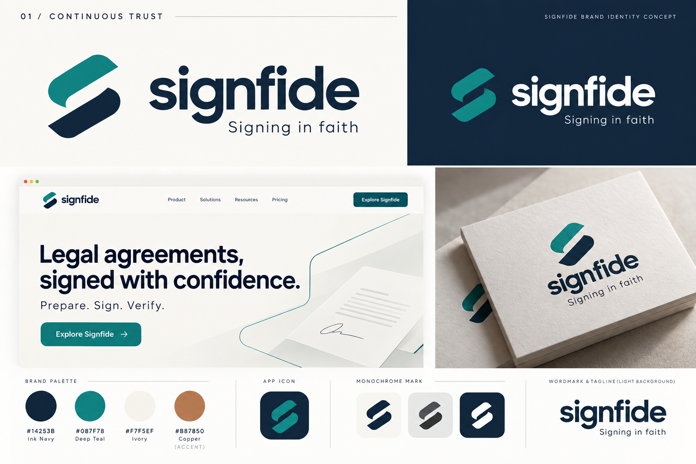
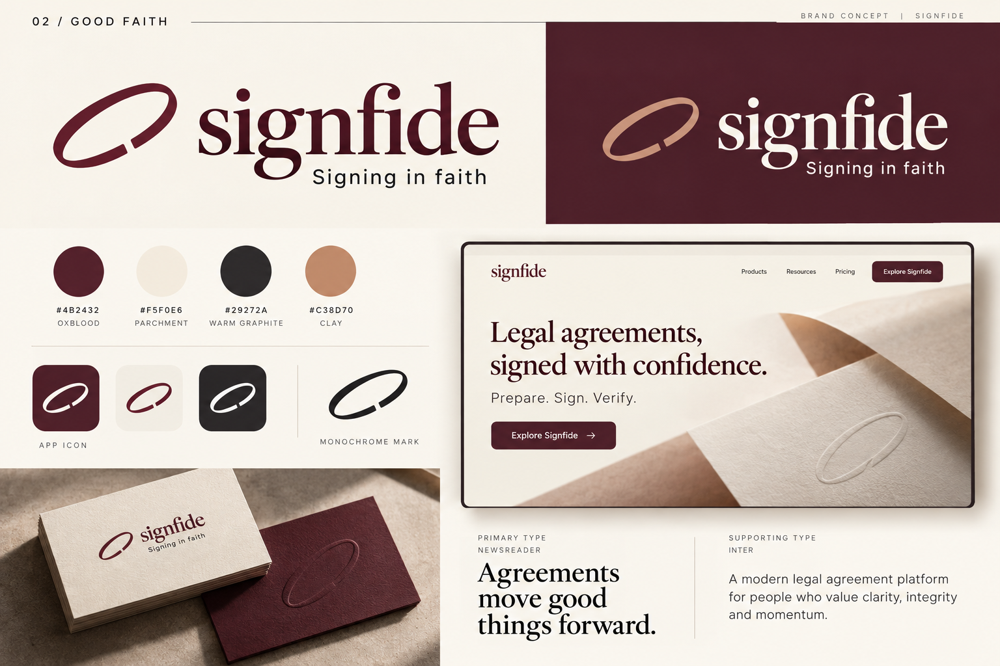
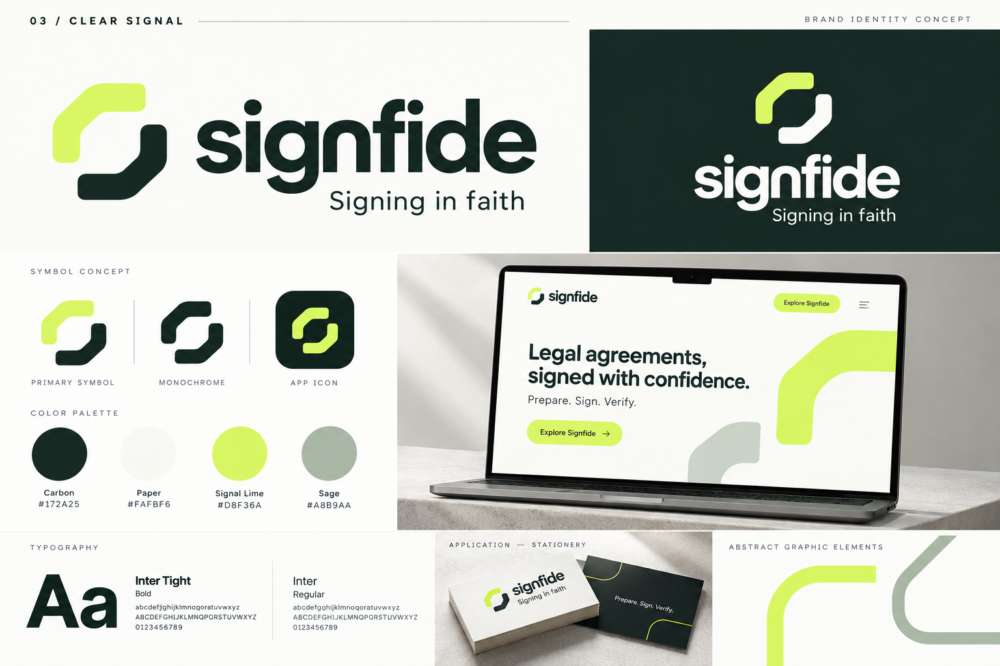

# Signfide — branding and visual options

Prepared 2026-10-14. Internal concepts for selection; no direction has been selected.

Based on the [internal brand brief](../Signfide_Internal_Brand_Strategy.md), the user's navy-and-teal identity reference, and the confirmed main motto and tagline: **Signing in faith**.

All three options position Signfide as a modern legal agreement brand. “Faith” expresses good faith and authentic agreements. The main tagline stays consistent; website headlines serve as supporting copy. Use “Powered by Circularo” as a secondary endorsement on company and trust materials.

## Compare the directions

| Option | Character | Choose this if… | Main tradeoff |
| --- | --- | --- | --- |
| 01 — Continuous Trust | Precise, professional, familiar | You want to develop the supplied navy-and-teal identity | The palette is familiar in technology branding |
| 02 — Good Faith | Warm, editorial, premium | You want a more distinctive legal-market brand | The editorial style needs a simpler treatment inside the product |
| 03 — Clear Signal | Minimal, confident, digital | You want an identity led by product clarity and usability | It signals software more strongly than legal specialization |

## 01 — Continuous Trust

An evolution of the supplied reference. A diagonal, open S symbol represents continuity between preparation, signing, and the agreement record. A strong lowercase sans-serif wordmark keeps the identity approachable.

| Colour | Hex | Intended role |
| --- | --- | --- |
| Ink navy | `#14253B` | Wordmark, headings, dark surfaces |
| Deep teal | `#087F78` | Symbol, buttons, active elements |
| Ivory | `#F7F5EF` | Light backgrounds |
| Copper | `#B87850` | Occasional editorial accent |

Typography direction: Manrope for headings, Inter for body and interface text; custom wordmark lettering during refinement.

Applications: an ivory website with teal actions, a navy app icon, restrained agreement graphics, and uncoated stationery. Keep a flat, single-colour logo master for small sizes and document use.

## 02 — Good Faith

A warmer interpretation of the brand. An open signature loop pairs with a contemporary serif wordmark, connecting the idea of good faith to the human act of making an agreement. Parchment and oxblood establish a distinctive visual tone.

| Colour | Hex | Intended role |
| --- | --- | --- |
| Oxblood | `#4B2432` | Wordmark, primary actions, dark surfaces |
| Parchment | `#F5F0E6` | Main background |
| Warm graphite | `#29272A` | Supporting text |
| Clay | `#C38D70` | Accent and illustration |

Typography direction: Newsreader for editorial headings, Inter for body and interface text; custom serif wordmark lettering during refinement.

Applications: editorial website layouts, tactile stationery, warm agreement imagery, and a simple loop app icon. Use the serif selectively in the product so document controls and workflows remain clear.

## 03 — Clear Signal

A minimal identity centred on clarity and forward movement. An abstract geometric alignment symbol accompanies a bold lowercase wordmark. Carbon and paper provide restraint; signal lime adds a recognisable digital accent.

| Colour | Hex | Intended role |
| --- | --- | --- |
| Carbon | `#172A25` | Wordmark, text, dark surfaces |
| Paper | `#FAFBF6` | Main background |
| Signal lime | `#D8F36A` | Selected actions and focal accents |
| Sage | `#A8B9AA` | Supporting surfaces and graphics |

Typography direction: Inter Tight for display headings, Inter for body and interface text; custom wordmark lettering during refinement.

Applications: a clean product website, compact app icon, simple interface elements, and graphic lines derived from the symbol. Pair lime backgrounds with dark text and keep the accent selective.

## Recommendation

**02 — Good Faith** is my preferred direction for a distinctive US legal-market brand. Its warm palette and editorial character complement the confirmed tagline and provide more distance from familiar eSignature branding.

**01 — Continuous Trust** is the strongest choice if continuity with the supplied reference matters most. **03 — Clear Signal** suits a product-led identity with a more contemporary software character.

The boards illustrate directions rather than final vector assets. After selection, refine the mark geometry and wordmark, define exact typography and spacing, and validate colour contrast and small-size reproduction. Typeface names and hex values above are the proposed specifications; generated images are visual approximations.
