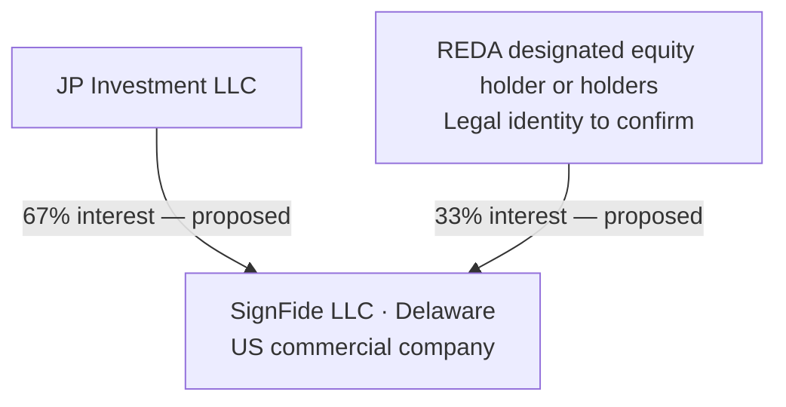
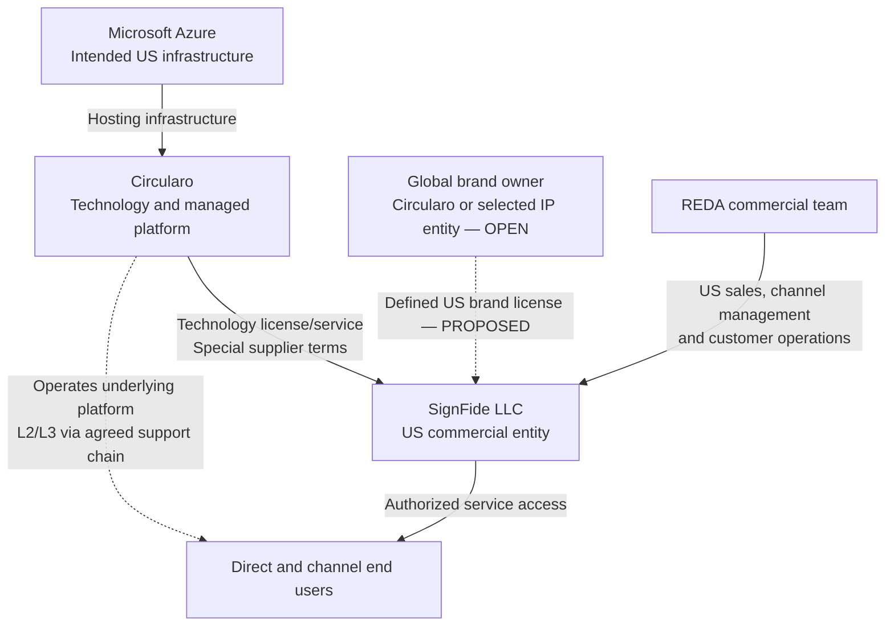
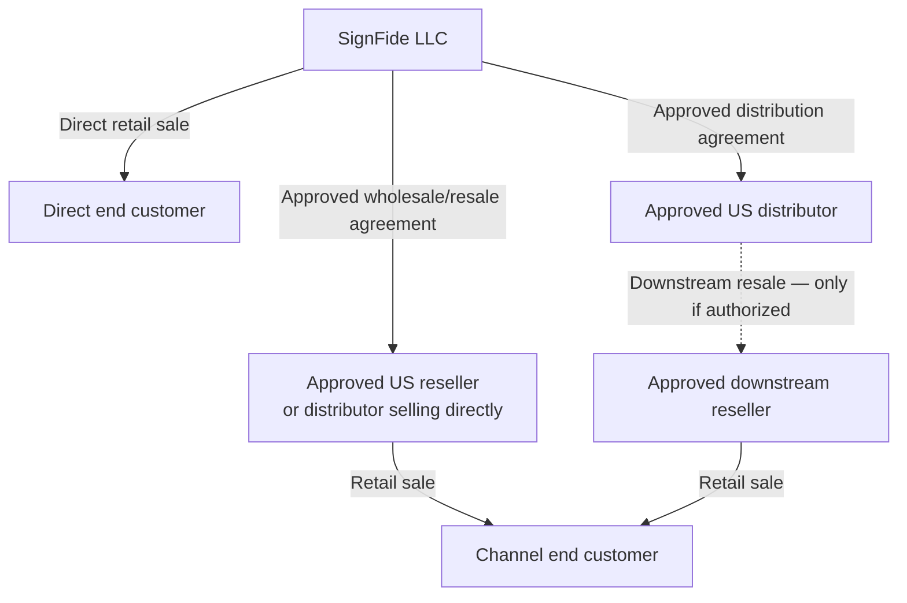

# SignFide corporate structure and commercial model

Date: 2026-10-14  
Status: Internal structure proposal for founder discussion  
Classification: Confidential  
Basis: Josef’s company principles, the selected Option A operating model, and his instruction that SignFide will sell directly to end customers and through approved US distributors or resellers. Internal working material, non-canonical.

## Structure at a glance

**SignFide LLC is the US commercial company and Signfide is the customer-facing brand.** JP Investment LLC holds the proposed 67% interest and REDA’s designated holder or holders hold the proposed 33%. REDA’s team operates the US commercial business for SignFide. Circularo supplies the technology and agreed license/service on special commercial terms and operates the platform under Option A.

SignFide has two routes to market: direct end-customer sales and approved US channel sales. A channel partner is an independent commercial counterparty, not a SignFide subsidiary or shareholder by virtue of its appointment. An end customer purchases the agreed service/use rights; the model does not grant ownership in SignFide, its brand, or the underlying technology.

Global brand ownership and the US brand license remain open decisions. The discussion proposal is for Circularo or a selected IP entity to hold the brand portfolio and license defined US use to SignFide LLC. The diagrams mark that proposal separately from the intended commercial routes. No formation, trademark title, signed agreement, or appointed distributor is verified by this document.

## Corporate ownership

The proposed interests total 100%. Voting, management, distributions, funding, transfers, performance conditions, and exit rights need their own agreed provisions. The 67/33 split is not a complete governance model.

Circularo is shown as the technology supplier, not as the direct 67% member. The relationship between Circularo and JP Investment has not been specified here. Ultimate ownership above JP Investment, Circularo, and REDA’s designated holders has not been supplied and must not be inferred.

REDA has two distinct roles: the contribution and rights of its designated equity holders, and the operating commitments of REDA’s commercial team. Holding 33% does not, in this proposal, automatically create a separate distributor margin, salary, commission, or global brand interest; any additional compensation or rights must be expressly agreed.

## Entity and role map

| Entity or role | Purpose in the structure | Relationship to SignFide |
| --- | --- | --- |
| JP Investment LLC | Proposed majority investor/member | Proposed 67% membership interest; company-governance rights to agree |
| REDA designated equity holder or holders | Proposed minority investor/member group | Proposed 33% interest; exact holders and contribution terms to confirm |
| REDA commercial team | US market development, sales execution, channel management, and customer lifecycle | Performs agreed work for SignFide under the cooperation and contribution arrangements |
| SignFide LLC | US contracting, selling, channel, billing, and customer-management entity | The joint company; approved US operator of the Signfide proposition |
| Circularo contracting entity | Technology, license/service supply, platform operations, L2/L3 technical support | Supplier under the Circularo–SignFide agreement; exact legal entity to confirm |
| Global brand/IP owner | Hold and administer the selected brand portfolio | Circularo or a selected IP entity is a proposal; US brand license and title remain open |
| Approved US distributor | Purchase authorized supply for resale; potentially manage an approved downstream channel | Independent partner under a SignFide distribution agreement |
| Approved US reseller | Sell the authorized offering to end customers, directly appointed or supplied through an approved distributor | Independent partner under the applicable channel agreement |
| Direct end customer | Purchase and use the offering directly | Customer sales/order relationship with SignFide |
| Channel end customer | Purchase through an approved channel seller | Retail sales relationship with that seller; platform-use/data arrangements must be defined |
| Microsoft Azure | Intended US infrastructure vendor under Option A | Infrastructure managed by Circularo; no ownership interest or independent sales role in this model |
| Stripe | Proposed payment-processing capability for SignFide’s own collections | Payment provider; not an equity holder, distributor, or assumed merchant of record |
| SignFide’s US bank | Receive SignFide funds and support approved company payments | Account provider; bank and account status to confirm |

The final global brand owner, platform IP rights, creator assignments, and authority to grant onward use must be reconciled before signing. Brand-use permissions for channel partners should flow through the approved license chain; they must not exceed SignFide’s own rights.

## Technology, brand, and operations

Solid arrows here describe intended supply or operating relationships, not ownership. Dashed arrows identify the proposed brand license or technical delivery relationship. Direct technical access to a Circularo-operated platform does not by itself identify the retail seller, payment collector, or customer contracting entity.

Under Option A, approved distributors and resellers do not assume platform hosting, deployment, monitoring, or release operations merely by reselling the offering. Circularo retains the agreed managed-platform role. Options B and C require a separate approved operating model and RACI.

## US commercial routes

Direct selling and approved US channel selling are the user-specified direction. The one-tier and two-tier arrangements below are proposed ways to implement channel selling. Appointment criteria, permissions, commercial terms, and whether to activate a downstream distribution tier remain open.

### Direct customer route

1. SignFide, operated commercially by REDA’s team, acquires and qualifies the customer and issues the approved offer.
2. The customer contracts with SignFide under the approved order and customer terms, with the required service and data arrangements.
3. SignFide invoices and collects the customer payment. Stripe may process SignFide’s payment flow, with the agreed payout destination in its US bank account.
4. REDA sends the authorized provisioning request; Circularo provisions and operates the agreed underlying service.
5. SignFide/REDA owns onboarding, training, account management, and first-line customer support. Circularo handles qualified platform escalations and the managed technology operation.

### One-tier reseller route

1. SignFide appoints an approved reseller, or a distributor that is authorized to sell directly to end customers.
2. SignFide supplies the authorized offer to that partner under agreed wholesale/resale terms.
3. The partner contracts with and invoices the end customer as the retail seller under the agreed channel model. The partner pays SignFide under the wholesale agreement.
4. The end customer accepts the applicable platform-use and data arrangements. The proposed standard is a SignFide service-terms relationship alongside the partner’s retail order; the parties must confirm the final contract structure rather than assume the resale order alone creates that relationship.
5. The partner supplies the required customer/order information and agreed onboarding or frontline support. SignFide/REDA coordinates the account, provisioning, and escalations. Circularo remains the platform operator.

This is a proposed buy-and-resell model. If a partner only introduces customers while SignFide contracts and bills directly, that is a separate referral/agency arrangement with its own compensation and authority rules, not the reseller model shown above.

### Two-tier distribution route

If expressly approved, SignFide supplies a distributor, the distributor supplies an approved downstream reseller, and that reseller sells to the end customer. Contracts, orders, and invoices follow each commercial step. Platform provisioning and the applicable end-customer service terms must still be traceable through the chain.

A distributor must not be assumed to have permission to appoint unlimited sub-resellers, extend territory, change the service scope, transfer the brand license, or promise Circularo obligations. The distribution agreement must state what onward appointments and permissions are allowed and how approval is recorded.

## Contract and invoice map

| Sales route | Commercial contract and invoice chain | End-customer retail seller and collector | Platform-use relationship to settle |
| --- | --- | --- | --- |
| Direct | SignFide → end customer | SignFide | SignFide customer/service terms and applicable data arrangements |
| One-tier resale | SignFide → approved partner → end customer | Approved partner | Proposed SignFide platform-use terms plus partner retail order; exact structure to agree |
| Two-tier distribution | SignFide → approved distributor → approved downstream reseller → end customer | Downstream reseller | Same platform-use requirement, with sufficient order/consent records and responsibilities across both channel levels |

For every route, identify the seller, invoicing entity, collector, refund decision-maker, renewal owner, tax/accounting responsibilities, customer contact, and applicable terms. SignFide’s authorized management approves the channel contracts; REDA prepares and operates the program within that authority.

This structure does not appoint Circularo as the direct retail contracting party for every SignFide customer. Any separate mandatory Circularo end-user terms or direct contractual relationship must be expressly identified and reconciled with SignFide’s and the partner’s terms.

## Money flows and commercial economics

| Flow | Proposed movement | Commercial purpose |
| --- | --- | --- |
| Direct retail payment | Direct end customer → SignFide, potentially processed by Stripe → SignFide US bank | Payment for the direct customer offer |
| One-tier retail payment | Channel end customer → approved reseller/distributor | Payment to the channel retail seller |
| One-tier wholesale payment | Approved reseller/distributor → SignFide | Payment for the authorized underlying supply |
| Two-tier payments | End customer → reseller → distributor → SignFide | Retail and successive wholesale payments under their respective agreements |
| Technology/service payment | SignFide → Circularo | Agreed upstream license/service and related charges on the special supplier schedule |
| Brand-license payment, if any | SignFide → selected brand owner | Only if separately agreed; no royalty or extra fee is assumed |
| Approved operating expenditure | SignFide → staff/providers or other authorized recipients | Company-funded operations, kept distinct from REDA’s own contribution |
| Member distributions, if any | SignFide → members under agreed company arrangements | Separate from customer payments, supplier fees, salaries, or channel margins |

In commercial planning, SignFide’s direct route has the direct selling price and its upstream/service/operating costs. Its channel route uses the agreed wholesale receipt and those costs. A reseller’s commercial margin depends on its resale proceeds, purchase terms, and own costs; a distributor’s margin depends on its supply and onward-sale terms. No numerical prices, margin guarantees, commissions, tax treatment, or accounting revenue recognition are established here.

Stripe does not automatically collect every channel end-customer payment for SignFide. Under the proposed resale model, each retail seller has its own agreed collection arrangements. Any centralized checkout, agency collection, split-payment, or payment-on-behalf-of model needs an expressly approved design and contractual allocation.

Partner pricing, discounting, territory, and direct/channel competition rules require US legal review before adoption. The FTC notes that resale-price requirements can be treated differently under federal and state law; this document sets no mandatory resale price or price-coordination policy. [FTC supply-chain guidance](https://www.ftc.gov/advice-guidance/competition-guidance/guide-antitrust-laws/dealings-supply-chain/manufacturer-imposed-requirements).

## Customer delivery and support chain

| Activity | Direct route | Channel route | Circularo role under Option A |
| --- | --- | --- | --- |
| Customer acquisition and commercial sale | SignFide/REDA | Approved partner, with SignFide/REDA program oversight | Agreed technical input |
| Customer order and billing | SignFide/REDA | Retail seller; upstream orders/payment through channel | Supplier order/billing relationship with SignFide |
| Customer onboarding and training | SignFide/REDA | Partner where assigned; SignFide/REDA ensures coverage and escalation | Agreed technical consultation |
| First customer support contact | SignFide/REDA | Partner where assigned; SignFide/REDA fallback and coordination | Qualified L2/L3 technical escalation |
| Tenant/subscription provisioning | SignFide/REDA coordinates the authorized request | Partner request validated and coordinated by SignFide/REDA | Underlying platform provisioning |
| Hosting, monitoring, upgrades, platform incidents | SignFide/REDA communicates with customer | SignFide/REDA coordinates partner/customer communication | Platform operation and technical resolution |
| Renewal, cancellation, payment disputes | SignFide/REDA within approved authority | Contractual retail seller with agreed upstream coordination | Authorized service changes and supplier-side obligations |

Channel delegation must leave no customer without support. SignFide/REDA remains accountable for the channel program and its customer-lifecycle coverage. A partner’s first-contact role does not transfer platform obligations to that partner or transfer SignFide’s program ownership to Circularo.

## Approval and channel safeguards to agree

- Identify whether a partner is a reseller, a direct-selling distributor, a two-tier distributor, or a referral partner. Confirm approved legal entity, territory, products, service capability, and order/payment arrangements.
- Use explicit onward-resale and brand permissions. Any authorization must fit within SignFide’s own upstream technology and brand rights. Appointment does not create equity or grant global rights.
- Establish deal registration, named-account rules, lead routing, online/direct-sales treatment, renewal ownership, and a conflict process for SignFide’s simultaneous direct and channel business.
- Define credit exposure, payment timing, refunds, disputed orders, subscription suspension, and treatment of a partner that fails to pay after collecting from a customer.
- Require agreed product/assurance claims, customer terms, support coverage, data-handling arrangements, and escalation practices across the chain.
- Keep subscription, end-customer entitlement, seller, and renewal records traceable in authorized systems. Give each party only the access its role requires.
- Define customer continuity and handover when a partner loses approval or exits, without assuming customer contracts or data can be moved automatically.

The detailed policies and commercial rights remain to be approved. The [open questions registry](open-questions.md) tracks the channel decisions alongside ownership, brand, performance, and exit protections.

## Agreements and schedules needed

| Document | Parties or scope | Main purpose |
| --- | --- | --- |
| SignFide LLC agreement and ownership documents | JP Investment and REDA’s designated holders; company as applicable | Membership, management, contributions, distributions, reserved decisions, and exit |
| REDA cooperation and performance arrangements | Actual REDA counterparty, relevant Circularo party, and SignFide participation to agree | Commercial execution, resources, scorecard, RACI, remedies, and handover |
| Technology/reseller and managed-service agreement | Circularo ↔ SignFide | License/service scope, special supplier terms, Option A responsibilities, and resale authorization |
| US brand license | Selected brand owner ↔ SignFide | Territory, brand use, quality control, permitted partner use, term, and termination; ownership remains open |
| Channel distribution/reseller agreement | SignFide ↔ approved partner | Authorized route, wholesale supply, onward appointments, orders, billing, support, claims, and termination |
| Downstream reseller terms, if permitted | Distributor ↔ approved reseller | Required flow-downs, supply and payment terms, and customer coverage |
| Customer order and service terms | Direct seller ↔ customer, plus agreed platform-use relationship | Retail commitment, subscription/use, responsibility, renewal, and cancellation |
| Service, data, security, and support schedules | Relevant supplier, company, partner, and customer parties | Align the operational and data obligations with the actual route and configuration |
| Bank/Stripe and other operational provider arrangements | Relevant account holder ↔ provider | Payment processing, account access, reconciliation, and approved company funds handling |

The agreement set must be reconciled end to end. A wholesale/resale contract must not promise wider rights or stronger service obligations than SignFide receives upstream. A corporate ownership interest must not be used as a substitute for a technology license, brand license, channel appointment, or customer contract.

## Decisions still open

The confirmed planning direction is **US direct sales plus approved US channel sales**. The following remain decisions for the founders and authorized parties:

1. Exact legal entities, membership implementation, management, and signing authority.
2. Global brand/IP owner and the US license, including onward brand use and non-US rights.
3. One-tier versus two-tier channel permissions and partner-approval criteria.
4. Commercial seller, platform terms, payment collector, and tax/accounting responsibilities for each route.
5. Special supplier pricing, wholesale terms, partner economics, credit, and payment design.
6. Direct/channel account rules, support allocation, renewals, and partner-exit continuity.

No customer prices, partner discounts, exclusivity, additional ownership interests, automatic sub-reseller rights, or actual partner appointments are created by this discussion structure.
